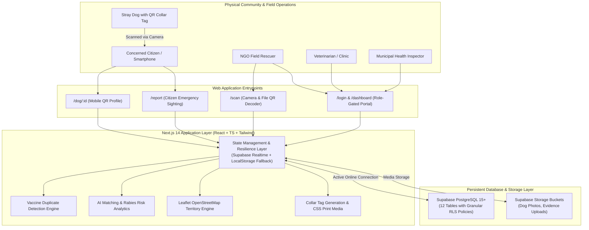

# RescueAI — AI-Powered Stray Dog Identification & Vaccination Management

[](https://nextjs.org/)
[](https://react.dev/)
[](https://www.typescriptlang.org/)
[](https://tailwindcss.com/)
[](https://supabase.com/)
[](https://leafletjs.com/)
[](https://opensource.org/licenses/MIT)

> **“Every Dog Has a Story. Every Life Deserves Care.”**

RescueAI is a comprehensive, production-ready web application designed for animal welfare NGOs, veterinarians, municipal corporations, rescue volunteers, and concerned citizens. The platform connects every registered stray dog with a unique digital identity via a durable, QR-coded physical collar tag. When scanned with any mobile smartphone camera, the tag opens the dog's public health record, facilitating immediate identification, emergency citizen reporting, duplicate-safe vaccination tracking, and community-wide rabies prevention.

---

## 📑 Table of Contents

1. [System Architecture](#-system-architecture)
2. [Key Capabilities & Features](#-key-capabilities--features)
3. [Technology Stack](#-technology-stack)
4. [Project Structure](#-project-structure)
5. [User Roles & Permissions (RBAC)](#-user-roles--permissions-rbac)
6. [Quickstart & Local Installation](#-quickstart--local-installation)
7. [Supabase Setup & Database Migrations](#-supabase-setup--database-migrations)
8. [Demonstration Mode & Test Credentials](#-demonstration-mode--test-credentials)
9. [20-Step End-to-End Workflow Verification](#-20-step-end-to-end-workflow-verification)
10. [Hardware Collar Tag Specifications](#-hardware-collar-tag-specifications)
11. [Vercel Deployment Guide](#-vercel-deployment-guide)
12. [Ethical AI & Public Health Notice](#-ethical-ai--public-health-notice)

---

## 🏛️ System Architecture



---

## 🚀 Key Capabilities & Features

### 1. Digital Stray Dog Registry & Collar Tagging
- **Unique Digital Identity**: Generates standardized IDs (e.g., `DOG-001`, `DOG-002`) and collar serials (`COL-001`).
- **Physical QR Tag Generator**: Built-in 50mm circular medallion and 70mm rectangular printable templates with vector QR codes, emergency NGO hotline numbers, and microchip cross-references.
- **Micro-chipping & Sterilization Status**: Tracks ear-notch status, sterilization date, approximate age, coat patterns, temperament, and primary home territory.

### 2. Clinical Vaccination Management & Duplicate Prevention
- **Prevent Over-Vaccination**: Intelligent safety engine intercepts attempts to administer repeat core vaccines (Rabies, DHPP/DHLPP, Bordetella, Leptospirosis) within dangerous clinical intervals (e.g. within 21 days for Rabies, or within 30 days for DHPP).
- **Batch & Manufacturer Tracking**: Logs manufacturer, batch/lot number, dose sequence, administration site, and booster schedules.
- **Vaccination Certificates**: Immediate printable verification records for municipal audit.

### 3. Comprehensive Veterinary History & Rabies Quarantine
- **Clinical Encounter Records**: Records SOAP-format clinical notes (Subjective, Objective, Assessment, Plan), diagnoses, surgeries, prescription regimens, and follow-ups.
- **Rabies Escalation Protocol**: Dedicated isolation and 10-day quarantine tracker with municipal health notification triggers for neurological/bite cases.

### 4. Physical Vitals & Activity Scoring
- **Health Tracking**: Logs weight (kg), rectal temperature (°C), body condition score (BCS 1–9), hydration, mobility, and coat condition over time.
- **Interactive Vitals Chart**: Visual weight and temperature trends rendered with Recharts.

### 5. Hardware Collar Device Lifecycle
- **Inventory Management**: Allocates, verifies, and tracks collar devices (`Active`, `Damaged`, `Pending Replacement`, `Decommissioned`).
- **Damaged Tag Replacement**: 1-click collar reassignment that retains the dog's complete medical history under a new QR tag.

### 6. Territory Mapping & Geolocation Sightings
- **OpenStreetMap Integration**: Interactive Leaflet maps pinpointing primary territory zones and recorded sightings.
- **Clarification**: QR collars are **passive, durable identification tags** rather than continuous battery-powered IoT GPS trackers. Geolocation coordinates represent verified sightings, capture points, and territory centroids.

### 7. AI-Assisted Welfare Intelligence
- **Visual Coat & Facial Matching**: Simulates deep visual embeddings to detect duplicate registrations across NGO boundaries and match lost dog photos.
- **Predictive Rabies Hotspot Modeling**: Correlates unvaccinated stray density, bite reports, and waste aggregation points to score municipal zones (Low, Medium, High, Critical).
- **Immunization Forecast**: Predicts upcoming community booster needs 30, 60, and 90 days in advance.

### 8. Citizen Rescue & Sighting Portal
- **Zero-Barrier Reporting**: Mobile-optimized form for citizens to report injured, sick, or aggressive strays with photo evidence and GPS coordinates.
- **Unique Tracking Code**: Generates citizen tracking tokens (e.g., `REP-72810`) to check resolution status.
- **Field Worker Dispatch**: Admins and NGOs can assign reports directly to field workers as actionable tasks.

---

## 🛠️ Technology Stack

| Layer | Technologies |
| :--- | :--- |
| **Frontend Framework** | [Next.js 14](https://nextjs.org/) (React 18, Pages Router, TypeScript) |
| **Styling & Design** | [Tailwind CSS 3.4](https://tailwindcss.com/), Custom Design System |
| **Icons & Visuals** | [Lucide React](https://lucide.dev/) |
| **Charts & Analytics** | [Recharts 2.13](https://recharts.org/) |
| **Mapping Engine** | [Leaflet 1.9](https://leafletjs.com/), [React-Leaflet 4.2](https://react-leaflet.js.org/) |
| **QR Code Engine** | `qrcode.react` (SVG Generation), `html5-qrcode` (Live Camera & File Scanner) |
| **Database & Auth** | [Supabase](https://supabase.com/) (PostgreSQL 15+, Row Level Security, Auth) |
| **State & Resilience** | React Context (`RescueStore`), Graceful Offline Demonstration Fallback |
| **Deployment Target** | [Vercel](https://vercel.com/) / Static Web Export (`output: 'export'`) |

---

## 📁 Project Structure

```
email-forensics/
├── package.json              # Root package delegation scripts (npm run dev, build, start)
├── vercel.json               # Vercel deployment configuration for static export
├── .env.example              # Template environment variables
├── README.md                 # Master project documentation (this file)
├── supabase/
│   ├── schema.sql            # Full PostgreSQL DDL: 12 tables, custom ENUMs, RLS policies
│   └── seed.sql              # Production-grade PostgreSQL seed dataset
└── web/
    ├── package.json          # Next.js workspace package manifest
    ├── tsconfig.json         # Strict TypeScript compiler options
    ├── tailwind.config.js    # Custom forest-green & warm off-white palette configuration
    ├── next.config.js        # Next.js export & image configuration
    ├── public/               # Static assets & illustrations
    └── src/
        ├── components/
        │   ├── DashboardLayout.tsx      # Sidebar navigation, role switcher, notification drawer
        │   ├── Footer.tsx               # Public footer with emergency helplines & legal links
        │   ├── Navbar.tsx               # Responsive header with mobile drawer & quick scan
        │   ├── PrintableCollarTag.tsx   # 50mm circular & 70mm rectangular collar tag generator
        │   ├── QRScannerComponent.tsx   # html5-qrcode camera scanner & file decoder
        │   ├── RescueMap.tsx            # Leaflet OpenStreetMap with custom status markers
        │   └── StatusBadge.tsx          # Consistent color-coded badges
        ├── lib/
        │   ├── seedData.ts              # 14 realistic sample dogs, 25+ vaccines, clinical records
        │   ├── store.tsx                # Context provider, CRUD state, duplicate vaccine engine
        │   ├── supabaseClient.ts        # Resilient Supabase client with offline fallback
        │   └── types.ts                 # TypeScript interfaces, role definitions, and enums
        └── pages/
            ├── index.tsx                # Landing page with hero, how-it-works, features, impact
            ├── how-it-works.tsx         # Detailed 4-step physical-to-digital process guide
            ├── features.tsx             # Complete capability matrix
            ├── login.tsx                # Role-based 1-click test login & staff auth
            ├── register.tsx             # Organization & field staff onboarding
            ├── scan.tsx                 # Dedicated scanner page (camera, upload, manual ID)
            ├── report.tsx               # Public community rescue & dog sighting report form
            ├── privacy.tsx              # Privacy policy & data protection standards
            ├── terms.tsx                # Terms of use & ethical animal handling disclaimer
            ├── dog/
            │   └── [dogId].tsx          # Public-facing mobile QR dog profile page
            └── dashboard/
                ├── index.tsx            # Main overview: 8 metrics, Recharts graphs, priority dogs
                ├── activity.tsx         # Physical vitals logs (weight, temp, BCS) & chart
                ├── ai.tsx               # AI photo matching, duplicate detector, rabies risk modeling
                ├── alerts.tsx           # Notification center with severity filtering
                ├── analytics.tsx        # Printable audit reports, coverage charts, CSV export
                ├── devices.tsx          # Collar hardware lifecycle & replacement modal
                ├── map.tsx              # Territory map, sighting logger, filterable pins
                ├── medical.tsx          # Veterinary clinical encounters & rabies quarantine
                ├── reports.tsx          # Community report triage & field worker task dispatch
                ├── settings.tsx         # Reminder thresholds & public profile visibility controls
                ├── tasks.tsx            # Field worker task board (vaccination, rescue, follow-up)
                ├── users.tsx            # User directory & role permission matrix
                ├── vaccinations.tsx     # Immunization registry with duplicate warning engine
                └── dogs/
                    ├── index.tsx        # Dog directory with search, filters, grid/table view, CSV
                    ├── new.tsx          # Registration form with auto-ID & collar tag preview
                    └── [dogId].tsx      # Comprehensive 7-tab dog dossier with modal CRUD
```

---

## 👥 User Roles & Permissions (RBAC)

RescueAI features a 5-tier role-based access model:

| Role | Permissions & Operational Scope |
| :--- | :--- |
| **System Administrator** | Platform-wide oversight, user provisioning, role assignments, audit logs, duplicate record resolution, organization management. |
| **NGO / Field Worker** | Stray dog intake, collar QR assignment & tag printing, vaccination recording, field sighting logging, community report triage. |
| **Veterinarian** | Clinical exams, medical diagnoses, surgical notes, prescription management, rabies quarantine protocol escalation, vaccine verification. |
| **Municipal Authority** | Ward-level vaccination coverage inspection, rabies risk hotspot analysis, campaign planning, compliance audit reports. |
| **Concerned Citizen** | Public QR profile scanning, emergency injured/rabid dog reporting, sighting location logging, report progress tracking. |

> **Pro-Tip**: Use the **Role Switcher** in the top navigation bar of the dashboard to instantly test permissions across all 5 user types with zero re-login hassle.

---

## ⚡ Quickstart & Local Installation

### Prerequisites
- [Node.js](https://nodejs.org/) v18.17.0 or higher
- `npm` v9 or higher

### 1. Clone & Install Dependencies

```bash
# Clone the repository
git clone https://github.com/your-org/rescueai.git
cd rescueai

# Install root & workspace dependencies
npm install --prefix web
```

### 2. Configure Environment Variables (Optional)

RescueAI runs **100% out of the box in Demonstration Mode** without any external dependencies. To connect your own live Supabase instance:

```bash
# Copy the example environment file
cp .env.example web/.env.local
```

Edit `web/.env.local`:
```env
NEXT_PUBLIC_SUPABASE_URL=https://your-project-id.supabase.co
NEXT_PUBLIC_SUPABASE_ANON_KEY=your-anon-key-here
NEXT_PUBLIC_APP_URL=http://localhost:3000
```

### 3. Run the Development Server

```bash
# Start Next.js development server
npm run dev

# Or directly in web/
cd web && npm run dev
```

Open [http://localhost:3000](http://localhost:3000) in your browser.

### 4. Build for Production

```bash
# Verify static build and TypeScript compilation
npm run build
```

---

## 🗄️ Supabase Setup & Database Migrations

To deploy a live PostgreSQL backend with Supabase:

1. Create a new project on [Supabase.com](https://supabase.com).
2. Open the **SQL Editor** in the Supabase Dashboard.
3. Paste and execute the contents of [`supabase/schema.sql`](file:///Users/tirth/email-forensics/supabase/schema.sql):
   - Creates custom ENUM types (`user_role`, `health_status`, `vaccination_status`, `device_status`, `report_status`, `severity_level`).
   - Creates 12 relational tables with foreign keys and cascade rules.
   - Generates automated `updated_at` trigger functions.
   - Configures PostgreSQL **Row Level Security (RLS)** policies for all tables.
4. Paste and execute the contents of [`supabase/seed.sql`](file:///Users/tirth/email-forensics/supabase/seed.sql) to populate initial organizations, staff accounts, sample dogs, and clinical logs.
5. In **Storage**, create a public bucket named `dog-photos`.
6. Add your Supabase URL and Anon Key to `web/.env.local`.

---

## 🧪 Demonstration Mode & Test Credentials

If Supabase credentials are not provided, RescueAI automatically activates **Demonstration Mode**. In this mode:
- 14 realistic sample dogs, 25+ vaccination logs, 18+ medical encounters, 20+ vitals records, collar devices, sightings, and community reports are loaded into local memory.
- All additions, edits, collar replacements, and field reports persist in your browser's `localStorage`.
- A prominent amber badge confirms demonstration mode is active.

### Test Accounts

On the `/login` page, click any of the **1-Click Test Login** buttons, or use these credentials:

| Role | Email | Password | Representative Persona |
| :--- | :--- | :--- | :--- |
| **Administrator** | `admin@rescueai.org` | `admin123` | Dr. Sarah Jenkins (Platform Lead) |
| **NGO Field Worker** | `ngo.field@pawshope.org` | `ngo123` | David Martinez (PawsHope NGO) |
| **Veterinarian** | `dr.arun@metroclinic.gov` | `vet123` | Dr. Arun Patel, DVM (Metro Clinic) |
| **Municipal Officer** | `inspector.clara@metro.gov` | `muni123` | Officer Clara Vance (City Health) |
| **Citizen** | `citizen.alex@example.com` | `citizen123` | Alex Rivera (Community Volunteer) |

---

## 📋 20-Step End-to-End Workflow Verification

Follow this guided verification script to test every functional area of RescueAI:

1. **Landing Page Tour**: Visit `/` to review the hero statement, the 4-step process, the 9 core feature cards, and sample impact metrics.
2. **Field Worker Authentication**: Go to `/login` and click **"NGO Field Worker"**. Confirm immediate redirect to `/dashboard`.
3. **Dog Registry & Filtering**: Navigate to `/dashboard/dogs`. Search for `"Sheru"`, filter by `Vaccinated`, and toggle between Grid and Table views.
4. **Register a New Stray Dog**: Click **"Register New Dog"** (`/dashboard/dogs/new`). Enter a name, approximate age, breed, gender, and territory. Submit the form to verify auto-assigned Dog ID and QR collar pairing.
5. **Print QR Collar Tag**: Click **"Print Collar Tag"** from the new dog confirmation screen. Preview the 50mm circular medallion and 70mm rectangular tag with `@media print` layout.
6. **Access Dog Dossier**: Visit `/dashboard/dogs/DOG-001` (Sheru). Inspect the 7 profile tabs: Overview, Vaccinations, Medical History, Vitals, QR Device, Sightings, and Community Reports.
7. **Test Duplicate Vaccine Interceptor**: In the Vaccinations tab, click **"Add Vaccination"**. Choose `Rabies (Anti-Rabies)` with today's date. Observe the **Duplicate Immunization Alert** displaying: *"Warning: This dog received Rabies vaccine within the last 21 days"*.
8. **Veterinary Clinical Record**: Use the top bar to switch role to **Veterinarian**. In the Medical History tab, click **"New Clinical Record"**, enter clinical findings and prescriptions, and save.
9. **Rabies Quarantine Protocol**: Add a medical record with condition `"Suspected Rabies Contact"` and severity `"Critical"`. Confirm the red quarantine banner activates on the dog's dossier.
10. **Log Physical Vitals**: Go to `/dashboard/activity`. Record weight (18.5 kg), temperature (38.8 °C), and BCS (5/9). View the updated vitals line chart.
11. **Log a Geotagged Sighting**: Open `/dashboard/map`, click **"Log Sighting"**, select `DOG-002` (Bruno), enter coordinates (19.0820, 72.8850), and submit.
12. **Explore Territory Map**: Pan and zoom the Leaflet OpenStreetMap on `/dashboard/map`. Click any dog marker to open the detailed popup with health status and last seen timestamp.
13. **Test QR Scanner**: Visit `/scan`. Test camera scanning, drag-and-drop a QR code image, or click the demo shortcut button **"Simulate Scan: DOG-001 (Sheru)"**.
14. **Public QR Profile**: Verify redirection to `/dog/DOG-001`. Confirm public-safe view displays rabies vaccination status, sterilization badge, and emergency contact button.
15. **Submit Citizen Emergency Report**: Visit `/report`. Enter sighting details for an injured dog, click **"Use My Current Location"**, upload an optional photo, and submit to receive a reference code (e.g. `REP-91823`).
16. **Municipal Hotspot Analysis**: Switch role to **Municipal Authority** and navigate to `/dashboard/analytics`. Inspect the **Rabies Risk Hotspot Matrix** and ward vaccination coverage charts.
17. **AI Photo Matching & Duplicate Detection**: Go to `/dashboard/ai`. Select a photo to test similarity matching against registered dogs, and inspect the algorithmic risk forecast.
18. **Triage & Worker Dispatch**: Visit `/dashboard/reports`. Click **"Dispatch Worker"** on a pending citizen report to assign it to field worker David Martinez. Check `/dashboard/tasks` to confirm task assignment.
19. **Export Audit Report**: Go to `/dashboard/analytics`, click **"Print Audit Report"** to view the printable municipal summary, or click **"Export CSV"** in the Dog Registry.
20. **Settings & Role Permission Audit**: Navigate to `/dashboard/settings` to adjust vaccination reminder thresholds (30 days) and toggle public field visibility. Visit `/dashboard/users` to review RBAC matrices.

---

## 🏷️ Hardware Collar Tag Specifications

RescueAI formats physical identification tags using durable, outdoor-grade industrial standards:

```
+-----------------------------------------------------------+
|                     RESCUEAI DIGITAL ID                   |
|  +-------------+   Dog: SHERU                             |
|  | [QR CODE]   |   ID: DOG-001                            |
|  |             |   Collar: COL-001                        |
|  |             |   Status: VACCINATED (RABIES SAFE)       |
|  +-------------+   Sterilized: YES (Ear-Notched Right)    |
|                                                           |
|  Scan with any phone camera to view medical history       |
|  Emergency Animal Helpline: +91 98200 12345 / 1962        |
+-----------------------------------------------------------+
```

### Physical Printing Profiles:
- **Profile A — 50mm Circular Medallion**: Anodized aluminum or brass tag suitable for standard dog collar rings. Features QR code in center, Dog ID, and helpline number on circumference.
- **Profile B — 70mm x 35mm Rectangular Tag**: TPU / nylon waterproof collar strap insert with high-contrast black-on-white or laser-etched QR code, anti-scratch protective laminate, and human-readable microchip ID.

---

## 🌐 Vercel Deployment Guide

### Option 1: Vercel Dashboard (Recommended)
1. Push your repository to GitHub.
2. In Vercel, click **"Import Project"** and select the repository.
3. In **Project Settings**:
   - **Framework Preset**: Next.js
   - **Root Directory**: `web`
4. Add environment variables:
   - `NEXT_PUBLIC_SUPABASE_URL`
   - `NEXT_PUBLIC_SUPABASE_ANON_KEY`
5. Click **"Deploy"**.

### Option 2: Monorepo Root Deployment
The included root [`vercel.json`](file:///Users/tirth/email-forensics/vercel.json) is configured to automatically build and export from the `web` workspace:
```json
{
  "buildCommand": "npm run build",
  "outputDirectory": "web/out",
  "cleanUrls": true,
  "trailingSlash": true
}
```

---

## ⚖️ Ethical AI & Public Health Notice

- **Passive Identification**: Collar tags do not emit continuous radio frequencies or utilize battery-powered GPS hardware. Animal welfare is prioritized through lightweight, weather-resistant physical tags.
- **One Health Directive**: RescueAI operates in compliance with the **WHO / WOAH "Zero by 30"** global strategic plan to eliminate human deaths from dog-mediated rabies by 2030 through systematic 70%+ canine vaccination coverage.
- **Data Protection**: Sensitive volunteer personal phone numbers and internal medical dosage notes are shielded from public QR scans.

---

## 📄 License

This project is licensed under the **MIT License** — see the [LICENSE](LICENSE) file for details.

Developed with care for community animals worldwide.
